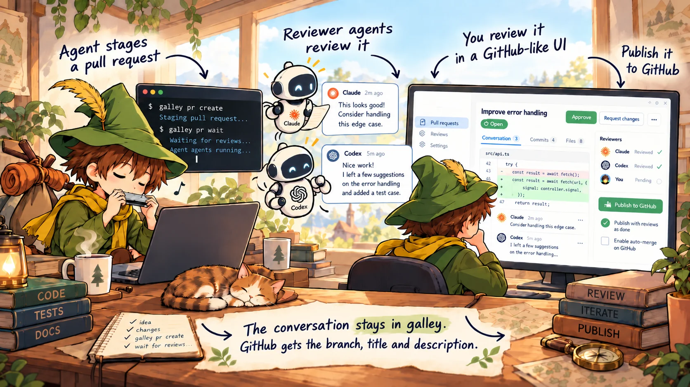

# Galley PR<i>oof</i>



A local staging area for pull requests from coding agents. An agent (Claude Code, Codex,
opencode, or any agent that can run `gh`) stages a pull request with a CLI that mirrors `gh`,
reviewer agents (Codex, Claude, or your own) review it, and you review it in a web UI that looks
like GitHub. When the title, description and commits are right, you publish it to GitHub. The
command is `galley`; on npm the package is `galley-proof`.

## Requirements

- Node 24 or newer
- git 2.38 or newer
- [gh](https://cli.github.com), logged in, where the server runs: galley fetches from GitHub and
  publishes with its credentials
- jq, for `--jq`
- For reviewer agents: Codex or Claude Code, installed and logged in
- On Linux, for reviewer agents: unprivileged user namespaces, which Ubuntu 23.10 and later
  restrict with AppArmor (`kernel.apparmor_restrict_unprivileged_userns`); for Claude,
  bubblewrap and socat too

## Install

From npm, where the package is called galley-proof and the command it installs `galley`:

```sh
npm install --global galley-proof
```

Or from a checkout, which follows `git pull`:

```sh
git clone https://github.com/laat/galley && cd galley
pnpm install
ln -s "$PWD/bin/galley.ts" ~/.local/bin/galley   # or: npm link
```

Then ask an agent to stage its pull request with `galley pr create` instead of `gh pr create`.
`galley --help` lists the commands, which take the same subcommands and flags as `gh`.

To use it as a gh extension too (`gh galley pr create …`):

```sh
dir="${XDG_DATA_HOME:-$HOME/.local/share}/gh/extensions/gh-galley"
mkdir -p "$dir" && ln -s "$(command -v galley)" "$dir/gh-galley"
```

## Run

```sh
galley serve            # http://localhost:24823
```

Run it once on the machine that keeps your pull requests. After that you rarely need to: when
no server is running there, the CLI starts one in the background (log in
`~/.local/share/galley/server.log`). It starts none on a machine where galley has never run, so
a forgotten `url` fails instead of starting a second galley. `GALLEY_NO_AUTOSTART=1`
turns starting off. When another program has the port, the CLI and `galley serve` say so;
`GALLEY_PORT` moves galley to another.

galley stages pull requests of GitHub repositories, and keeps its own clone of each in its data
directory. Before the author's commands on a pull request, such as `galley pr wait`, the CLI
sends the agent's branch there with git, and when galley tells the agent to rebase, it fetches
what galley fetched from GitHub into the checkout. The CLI keeps a remote called `galley` in the
checkout for this: what galley fetched is in `galley/<branch>`, and `origin` stays as you last
fetched it. A staged branch's `git push` goes to galley, not GitHub, until its pull request is
merged or closed, and then where it went before. A remote called `galley` of your own is left
alone. The server publishes from its clone with `gh`'s credentials and your signing key, so they
must work where it runs. If an agent's sandbox blocks them, start the server yourself. Stopping
the server lets running reviews finish for up to 10 minutes; a second Ctrl-C stops it at once.

To open galley from your other devices on a [Tailscale](https://tailscale.com) network, keep it
on 127.0.0.1 and let `tailscale serve` give it an HTTPS address on the tailnet:

```sh
tailscale serve --bg 24823
GALLEY_PUBLIC_URL=https://<host>.<tailnet>.ts.net galley serve
```

Links galley gives, such as **Copy link** and the ones agents print, then use that address, so
they open on your other devices too. Another proxy in front of galley should set `X-Forwarded-For`,
or pages on your other devices try to open the [desktop app](#desktop-app) of the server's machine.

## Other machines

For agents on another machine to stage on your galley, write its tailnet address in
`~/.config/galley/config.json` there:

```json
{ "url": "https://<host>.<tailnet>.ts.net" }
```

Every agent on that machine reads it, whatever app starts the agent. `GALLEY_URL`, when set,
takes its place.

That machine needs only the CLI: `npm install --global galley-proof`, or a checkout without
`pnpm install`:

```sh
git clone https://github.com/laat/galley && cd galley
ln -s "$PWD/bin/galley.ts" ~/.local/bin/galley
```

The desktop app there opens that galley and starts none.

An agent's sandbox must let the CLI read `~/.config/galley/config.json`, and let it and the git
it runs reach that address. When it does not, the agent tells you that it cannot reach galley.

- Claude Code: add the host to `sandbox.network.allowedDomains` in `~/.claude/settings.json`:

  ```json
  { "sandbox": { "network": { "allowedDomains": ["<host>.<tailnet>.ts.net"] } } }
  ```

- Codex: turn on network access for its workspace-write sandbox in `~/.codex/config.toml`. This
  lets the commands it runs reach any address, not only galley's:

  ```toml
  [sandbox_workspace_write]
  network_access = true
  ```

galley itself can move to another machine, such as a Linux server that is always on. Besides
the [requirements](#requirements), those for reviewer agents included, that machine needs:

- gh logged in with the `workflow` scope, to publish changes to GitHub Actions workflows:
  `gh auth login -s workflow`
- your signing key in its global git config, and on GitHub as a signing key, to publish signed
- the package managers your repositories use, for reviewer agents to install with

`galley serve --check` says what of this it finds. Install galley there as above, give it a
tailnet address with `tailscale serve --bg 24823`, and run it as a service with
`GALLEY_PUBLIC_URL` set to that address. On Linux, a systemd user unit in
`~/.config/systemd/user/galley.service`, with your paths; `PATH` must have node, git, gh, codex,
claude and the package managers:

```ini
[Service]
ExecStart=/usr/bin/node %h/galley/bin/galley.ts serve
Environment=PATH=%h/.local/bin:/usr/local/bin:/usr/bin:/bin
Environment=GALLEY_PUBLIC_URL=https://<host>.<tailnet>.ts.net
# Stopping it lets running reviews finish for up to 10 minutes.
KillMode=mixed
TimeoutStopSec=11min
Restart=on-failure

[Install]
WantedBy=default.target
```

```sh
systemctl --user enable --now galley
loginctl enable-linger    # keep it running while you are logged out
```

On macOS, a launchd agent in `~/Library/LaunchAgents` does the same, with the two variables in
`EnvironmentVariables`, `KeepAlive`, and an `ExitTimeOut` of 660 seconds.

To bring your pull requests along, start galley once where it runs now, so that it moves every
repository into a clone of its own. Then quit the desktop app, stop galley on both machines
(`systemctl --user stop galley` on the new one), and copy the data and settings over whatever the
new one has:

```sh
rsync -a --delete ~/.local/share/galley/ <host>:.local/share/galley/
rsync -a --delete ~/.config/galley/ <host>:.config/galley/
```

Start the service again, and move `~/.local/share/galley` aside on the old machine, so that
neither the CLI nor the desktop app starts a galley of its own there. Then set the `url` in
`~/.config/galley/config.json` on every machine, the server's and the old one included: in an
agent's sandbox, localhost may be the sandbox's own.

## Desktop app

On macOS, the checkout's `desktop/` has an app: galley in a window of its own with a Dock icon, a notification
when a pull request has been your turn for 10 seconds (clicking it opens the pull request), and a
menu-bar status. Next to its icon is the number waiting for you and, after ↻, the number the agents
or auto-publish are working on. Its menu lists the open pull requests in the front page's groups,
each with what it waits for, and has a Start at login switch. A published pull request whose next
move is on GitHub (checks, a review there, the merge) opens on GitHub, marked ↗ in the menu, from
the menu and from a notification alike; the others open in galley. ⌥-click one of yours to dismiss
it, or a dismissed one to make it your turn again. It is a window onto the server
the CLI uses: it starts one when none is running, as the CLI does, and quitting it leaves the
server running. Its window has no title bar of its own: galley's header holds the window's buttons,
drags the window, and stays at the top as you scroll. Uploaded images and raw files open in
windows of their own, with a title bar. As in Chrome, a two-finger swipe sideways goes back or
forward, and so do the mouse's side buttons, ⌘[ and ⌘], and ⌘← and ⌘→ outside a text field.

```sh
pnpm --dir desktop install
pnpm --dir desktop start     # run it from the checkout
pnpm --dir desktop build     # or build galley.app, unsigned, in desktop/out
```

The built app runs the checkout's code, so it follows `git pull`; keep the checkout where it is.
Its windows leave notifications to the app and have no **Notify me**.

While the built app runs, galley links on its computer open in its window: a link you click in
a terminal or another app, `galley browse` and `--web`. A page you open in the browser switches
to the app and says so in the tab, with **Stay in the browser** to keep that browser's links
there (**Settings > Desktop app** undoes it). Chrome asks before it opens the app; check
**Always allow** to skip that. **Open galley links in the app**, in the app's menu, turns all of
this off.

## The review loop

1. **The agent stages its branch** with `galley pr create` and waits with `galley pr wait`.
   The CLI sends the branch to galley; nothing goes to GitHub.
2. **Reviewer agents review it.** The agent answers them, commits and waits again, until they
   find nothing or reach their limit. Then it asks you to review.
3. **You review it.** Comment on lines, commit messages and the description, approve or request
   changes, or edit the title and description yourself.
4. **The agent addresses your feedback** and waits again. Comments follow their lines when it
   rewrites history, and reviewer agents review its new commits before you.
5. **You publish**, or the agent does when you asked it to ([Auto-publish](#auto-publish)).
   Publish pushes the commit you reviewed and opens the pull request on GitHub, or updates it.
   Publishing counts as your approval, over a request for changes before it. Approving publishes
   too, when nothing else is left: the reviewer agents are done, the agent is waiting with all
   feedback seen, your conversations are resolved, and the branch merges cleanly. It turns on
   [auto-publish](#auto-publish) with the publish box's defaults, which publishes at once.
   It can sign the agent's commits as you and turn on auto-merge. galley then shows the pull
   request's checks and reviews on GitHub, and tells the agent when it is merged.
6. **After that, GitHub's reviews and checks take over.** The agent commits and waits, and
   galley pushes each commit it waits with, without reviews here: signed as you published,
   force-pushed only over what galley pushed last, and with auto-merge asked for again if it
   was on. Its edits of the title and description are published when it waits too, unless you
   edited them since you published, or someone edited them on GitHub. A push GitHub refuses is
   not tried again, and you and the agent hear why; when someone added commits to the branch on
   GitHub, or rewrote it there, galley fetches it for the agent to rebase onto, and pushes the
   agent's new commits on top of it. A commit that would
   bring back what the rewrite removed is refused, unless you publish it yourself and choose to
   bring those commits back. One that fails otherwise (GitHub out of reach) is tried again when
   the agent next waits; one whose signing prompt nobody answered is tried again a few times
   over the next hour, whether the agent waits or not. When the branch conflicts with its base,
   galley tells the agent to rebase it, as before publishing, and pushes the rebase.

The conversation stays in galley; GitHub gets the branch, title and description.

Staged pull requests are numbered s#1, s#2, … ("s" for staged), so they are not mistaken for
GitHub's #1, #2. `s#4` in a comment or description links to it here; `#4` is GitHub's.

**Copy link** in a comment's **…** menu gives a link to it, and agents print one for each
thread. Opening it unfolds the thread or file the comment is in and scrolls to it.

An agent can give a link back to its session, such as its T3 Code thread, with `--link` on
`galley pr create` or `galley pr edit`. It is a button in the pull request's header and an icon
in its row on the front page, and it is never published to GitHub.

The front page lists the pull requests waiting for you first, each with the reason, then those
the agents are working on. A published pull request is your turn once GitHub can merge it and
auto-merge is off, and its title opens it on GitHub; its s#N opens it here, and **Update not
published** opens the box to publish the update from. One that auto-publish publishes on its own
is not your turn, unless it waits for something of yours, nor is a commit whose signing galley
tries again. **Notify me** shows a desktop notification when one has been your turn for 10
seconds. When one is not yours to act on (the team reviews it, say), dismiss it from its row or
its page: it is not your turn, counted or notified until something new happens, such as a commit,
a review or comment, an edit, or a change on GitHub. Until then it is under Dismissed, with Undo.

## Reviewer agents

Codex and Claude can review a pull request before you do. Turn them on in **Settings**. Each
reviews every new commit in a sandboxed checkout, with the dependencies installed so it can run
the tests, until it finds nothing, uses up its automatic reviews, or you publish. It is also
done with a commit once the author has seen its review and replied to or resolved each thread
the review opened. They only comment; the review decision is yours. A pull request's sidebar
shows what each is doing and its transcript, and lets you turn it on or off, change its limit,
or ask for a review now or stop the one running. The robot in the header, with how many reviews
are running, opens a page of the reviews running on every pull request, each with what it is
doing and a Stop button, and the latest finished ones. A running review's transcript has Stop
too. A review is kept with your other Codex or Claude Code sessions, so tools that count your
tokens from them, such as T3 Code, count it too. **Stop iterating** in the merge box ends the
automatic reviews. You can
also name reviewers when you ask an agent to stage; `galley reviewers` lists those that review a repository.

You can add reviewer agents of your own, each with its own instructions, in
`~/.config/galley/reviewers/<name>.md` or under **Settings** → Custom reviewers (a change there
rewrites the file without its comments). The front matter holds the settings, the body the
instructions:

```markdown
---
engine: claude            # or codex; also model, effort, max_iterations
repos: [nrkno/*]          # GitHub owner/name globs; left out: every repository
reviews: description      # the title, description and commit messages; or code
verdict: approve          # approve when it finds nothing; left out: comment only
---
Check the title and description against these rules: …
```

A description reviewer reviews again when the title, description or a commit message changes,
and until then its findings hold things up, whatever the replies.
A custom reviewer's approval is its own; it never counts as yours.

## Auto-publish

**Publish when reviews are done**, next to Publish, approves publishing in advance, like
GitHub's auto-merge. galley publishes once the reviewer agents are done with the latest commit,
the agent is waiting with all feedback seen, your conversations are resolved, and the branch
merges cleanly into its base. It is for the first publish only. Cancel, closing it, your own
Request changes, a new base or a failed publish turns it off; a signing prompt nobody answered
does so only after a few tries over the next hour. With **Enable auto-merge on GitHub** checked
too, GitHub merges it once its required checks pass.

When you ask the agent to publish or merge ("stage PR, publish and merge"), it turns on
auto-publish itself as it stages, and galley publishes the pull request as the agent, without
your review in galley; the timeline names the agent. An agent may publish, and turn auto-publish
on or off, only for the pull requests it staged. Bringing back commits a rewrite on GitHub
removed, deleting, pinning, settings and stopping automatic reviews stay yours.

## Settings

Your avatar in the header. Per reviewer agent: whether it reviews automatically, its name, model,
reasoning effort, limit of automatic reviews, whether it may install dependencies and run the
tests, whether it skips pull requests by its own kind of agent, and for Claude, whether those
tests may listen on localhost. Under Publishing: the merge method for auto-merge, and how many
times to try signing again. Changes save as you make them, a text field when you leave it.

| Variable | Default | |
|---|---|---|
| `GALLEY_URL` | `url` in `~/.config/galley/config.json`, or `http://localhost:24823` | Where the CLI and the desktop app find the server |
| `GALLEY_PORT` | `24823` | Port for `serve` and the default URL |
| `GALLEY_PUBLIC_URL` | the local URL | Where other machines reach the server (`serve --public-url`): its links use it, and it accepts requests to its host |
| `GALLEY_ALLOWED_HOSTS` | unset | More hosts, or host:port, the server accepts requests to, comma-separated (`serve --allowed-host`) |
| `GALLEY_HOME` | `~/.local/share/galley` | Server data directory |
| `GALLEY_CONFIG_DIR` | `~/.config/galley` | `config.json`, and custom reviewers in `reviewers/` |
| `GALLEY_ACTOR` | the detected agent | Who CLI calls act as |
| `GALLEY_USER` | your `gh` login | Your name in the UI |
| `GALLEY_GH` | `gh` | gh binary used for publishing |
| `GALLEY_CODEX` | `codex` | Codex binary used for reviews |
| `GALLEY_CLAUDE` | `claude` | Claude Code binary used for reviews |
| `GALLEY_NPMRC` | unset | An `.npmrc` that installs for reviews and the reviewer agents' commands read in place of `~/.npmrc`, such as one with a read-only token for private packages |
| `GALLEY_NO_AUTOSTART` | unset | Do not start a server when none is running |

## Security

- The server listens on 127.0.0.1 and refuses requests from web pages on other sites. Any
  process running as you can still call its API as you, publishing included, and send branches
  to its clones. An agent may
  publish the pull requests it staged; other agents are kept from publishing only by the name
  the CLI gives them, which `GALLEY_ACTOR` overrides
  ([#52](https://github.com/laat/galley/issues/52)).
- With a public URL, such as `tailscale serve`'s, every device that can reach it acts as you too.
  Never put galley on the internet (`tailscale funnel`).
- Secrets in a push are left to GitHub's push protection.
- Reviewer agents run code from the pull request in a sandbox with no network, except while the
  dependencies install. Code that gets past the install's precautions could reach the API.
  Turn off installing and running tests for repositories you do not trust. Claude installs in
  galley's own sandbox: sandbox-exec on macOS, bubblewrap on Linux. Where galley can not start
  one, it installs nothing. Of your home directory and the temporary directories, the commands
  Claude runs read only the review's checkout and the toolchains (Node.js, Go, Rust, Python,
  Java, .NET and their version managers), not your keys, tokens, logins or other projects; git
  gets your name and email and nothing else of your git settings, and npm only the `.npmrc` in
  `GALLEY_NPMRC`. Codex's sandbox still lets its commands read your files, with no network to
  send them over.
- **Let Claude's tests listen on localhost** lets code in the pull request reach anything on
  localhost, the API included, and other machines on your network reach a server it starts
  that does not listen on 127.0.0.1 only. Turn it on only for code you trust.

## More

- [`docs/api.md`](docs/api.md): the REST API under `/api`, GitHub's with galley's extensions.
- `galley --help`: the CLI, which takes the same subcommands and flags as `gh`.
